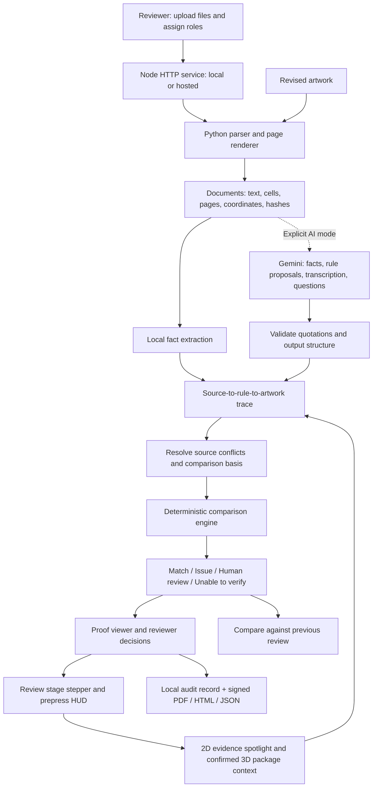

# Architecture

## Runtime responsibilities

| Component | Responsibility |
|---|---|
| `public/` | Reviewer workflow, proof spotlight, trace connectors, viewer controls, dieline face suggestions and reviewer-confirmed package preview; no provider keys embedded in code |
| `server.mjs` | Validated uploads, configured storage, serial jobs, APIs, session token, report requests, optional hosted Basic Auth |
| `lib/extract.py` | Bounded document parsing, PDF coordinates, page images, report generation |
| `lib/engine.mjs` | Source facts/conflicts, comparisons, evidence, revision changes |
| `lib/ai.mjs` | Bounded Gemini requests, schema, quotation constraints, provider errors |
| `lib/audit-signature.mjs` | Local Ed25519 sealing, portable proof generation and verification |
| `scripts/verify-report.mjs` | Offline integrity check for exported HTML or JSON proofs |
| `.packproof/` | Local records, original inputs, rendered pages and cached responses; excluded from submission. Hosted deployments point this data directory at a persistent disk. |

The prepress HUD derives millimeter coordinates from extracted PDF page dimensions. Raster-only inputs use normalized coordinates because print scale is unknown. Before showing “SHA-256 verified,” the browser fetches the locally stored original file and compares its digest with the extraction record. A PDF or image dieline can contribute positioned face-label hints and long-line candidates; these are not classified cut/crease paths or structural CAD geometry. Carton, pouch, bottle-label and sleeve contexts remain illustrative previews.

## Result semantics

| State | Meaning |
|---|---|
| Match | Supported comparison matches the supplied reference; scope remains bounded |
| Issue | An extracted value conflicts, or required copy is absent after coverage confirmation |
| Human review | Authority, interpretation, claims evidence, serving basis or vision output requires judgment |
| Unable to verify | Source/reference/extraction/implementation coverage is insufficient |

A reviewer disposition is a separate record. Acknowledgment never resolves a machine issue. A revision is resolved only when the supported check changes to matching. Removed checks are marked not rechecked.

## Limits and trust

The queue is local and serial. Atomic record replacement protects against partial file writes. Interrupted processing is marked failed after restart. Original documents are retained and hashed. This is not an immutable external audit ledger. A production service needs transactional concurrency controls, authentication, tenant isolation, encrypted storage, malware scanning, deletion policies and operations monitoring.
